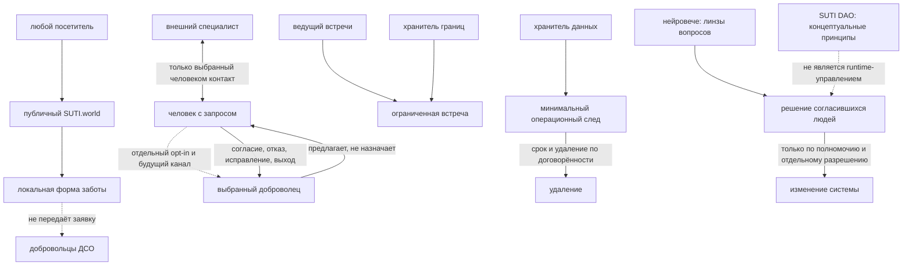

# Фламинго · ангелы заботы

**идентификатор:** `dso.flamingo-care.proposed.v1`  
**редакция:** 1.0 · 2026-11-04  
**авторская модель:** SUTI · Ezar Garuna  
**статус:** `DRAFT / PROPOSED / HOLD`  
**родительская модель:** [`suti-care-architecture.v1.md`](suti-care-architecture.v1.md)  
**проверка вече:** авторский разбор вопросов; реальных участников и голосования нет  
**внедрение:** не заявлено  

## кристалл решения

«Фламинго · ангелы заботы» — авторский образ добровольного круга поддержки.

ДСО — предлагаемая модель смешанного добровольного отряда. Названия «гаруновцы», «фламинго», «финисты», «велесты» — только добровольно выбранные самоописания и символические роли. Они не означают происхождение, должность, посвящение, ранг или полномочие.

Публичная форма SUTI.care остаётся самостоятельной локальной практикой. Она не отправляет запрос команде и не подтверждает существование дежурных, контакта, программы помощи или службы экстренного реагирования.

```text
заметить запрос → спросить согласие → выбрать границу
→ предложить один посильный ответ → проверить пользу → завершить или вернуться
```

**главный принцип:** забота поддерживает выбор человека; она не получает над ним власть.

## назначение и предел

Модель ДСО — один возможный закрытый добровольный контур внутри широкой самонавигации SUTI.care. Общая карта ситуаций и предпочтительных форматов описана в [`suti-care-architecture.v1.md`](suti-care-architecture.v1.md). ДСО не является входом ко всей заботе: публичный навигатор открыт всем, а участие в круге остаётся отдельным предложением.

Модель нужна для проектирования небольшого добровольного круга, который в будущем мог бы предлагать взаимную практическую и языковую поддержку.

Она не учреждает организацию и не объявляет круг действующим. Она не обещает постоянную доступность, безопасность, конфиденциальность, профессиональную квалификацию или результат.

Это не медицинская, психологическая, кризисная, юридическая, финансовая или социальная служба. Решения, требующие профильного специалиста или местного учреждения, остаются у человека и соответствующих специалистов.

## символические имена и членство

| имя в авторском образе | возможная функция в разговоре | предел |
|---|---|---|
| фламинго | мягкое приветствие и заметный знак входа | не ангельский статус и не обещание защиты |
| финист | образ перехода, восстановления и нового начала | не пророчество и не обещание преобразования |
| велест | образ памяти, языка и внимательного рассказа | не духовная власть и не хранитель чужой тайны по умолчанию |
| гаруновец | выбранная связь с авторским кругом Гаруна | не наследственный пропуск и не основание для доступа к данным |

Предлагаемая внутренняя принадлежность добровольна и ограничена людьми, которые сами выбирают одно или несколько этих самоописаний и отдельно соглашаются на участие. Никакой участник не назначает их другому человеку. Проверки происхождения, родословной или «подлинности» нет.

Публичные материалы SUTI.world остаются доступны широкой аудитории. Чтение сайта, использование практики, родство, дружба, обращение за помощью или участие в игре не означают членство в ДСО.

## сущности системы

| сущность | тип | положение | что может делать |
|---|---|---|---|
| человек, который просит поддержки | человек | автор собственного запроса | выбрать тему, формат, глубину, паузу, отказ и завершение |
| доброволец | человек | только по собственному согласию | предложить ограниченную помощь в пределах заявленной способности и времени |
| ведущий встречи | временная роль человека | назначается на одну встречу с согласием | держать тему, порядок и право остановки; не решать за участника |
| хранитель границ | временная роль человека | предложенная функция, ещё не назначенная | напомнить правила, остановить небезопасный формат, предложить выход или профильный ресурс |
| хранитель следа | временная роль человека | предложенная функция, ещё не назначенная | вести только минимальную согласованную запись, срок и удаление |
| организатор круга | человек | инициатор предложения, не владелец участников | готовить повестку и поддерживать договорённости без права на чужие данные |
| специалист внешней помощи | человек/учреждение | отдельная сторона, не часть ДСО автоматически | самостоятельно определить свои услуги, доступность и ответственность |
| публичный сайт SUTI.world | цифровая поверхность | работает; care-форма локальна | показать самоориентирование; не подбирает добровольца и не передаёт заявку |
| SUTI DAO | принцип управления | концептуальный, не активирован | служить словарём для решений; не выдавать голос, токен или автоматическое полномочие |
| нейровече | редакционный процесс | в этой редакции — симуляция линз автором | задавать вопросы и фиксировать разногласия; не подменять участников или согласие |
| фламинго / финист / велест | символические образы | авторский слой | поддержать добровольную метафору; не оценивать людей и не выдавать статус |

Список участников пуст. Реальные имена, контакты, заявления о согласии и график дежурств не создаются этой спецификацией.

## круги участия

Круги — разные уровни доступа и ответственности, а не ранги людей. Человек может отказаться от любого круга без санкции и объяснения.

| круг | кто входит | предмет работы | доступ по умолчанию |
|---|---|---|---|
| 0 · открытая нить | любой посетитель | бесплатная локальная практика и сведения о границах | публичные страницы; без передачи текста |
| 1 · круг намерения | автор запроса и приглашённый им доброволец, если такой канал будет создан | одна задача и согласованный формат контакта | только материал, который человек сам решил сообщить |
| 2 · круг практики | добровольцы, отдельно согласившиеся на конкретную встречу | ограниченная языковая или практическая поддержка | информация только для этой встречи; запись выключена |
| 3 · круг согласования | заранее названные и согласившиеся участники | правила, расписание, ресурсы и пересмотр модели | сводные решения; личные кейсы исключены |
| 4 · круг хранения | назначенный хранитель, если появится обоснованная потребность | минимальные операционные записи и удаление | отдельное разрешение; доступ закрыт и журналируется |
| внешний профессиональный контур | выбранный человеком независимый специалист или учреждение | помощь в пределах собственной компетенции | ДСО не передаёт сведения без отдельного разрешения человека |

Круги 1–4 — проектируемые. Сейчас реализован только круг 0, причём как самостоятельная форма, а не как канал ДСО.

## схема отношений



Пунктир показывает будущую возможность или отсутствие связи. Граф не описывает запущенный канал, платформу или доступ.

## правила отношений

- просьба о помощи не создаёт обязательства принять её.
- доброволец не становится куратором жизни человека.
- получатель поддержки и помогающий не смешиваются в одной встрече без явного согласия и проверки конфликта интересов.
- ведущий встречи не является судьёй, терапевтом или представителем всей группы.
- хранитель границ может остановить конкретную встречу; он не получает общего права контролировать участника.
- участие не создаёт долга, ранга, репутационного балла, духовного статуса или права требовать ответную услугу.
- символические роли можно не выбирать, менять и покидать.
- решение одного человека нельзя объявлять решением круга.
- круг не публикует чужой рассказ, благодарность, фото или отзыв без отдельного согласия на конкретный материал и конкретную публикацию.

## добровольные роли и разделение полномочий

Роли назначаются только на ограниченный срок или конкретную задачу, принимаются добровольно и могут быть прекращены без объяснения.

| роль | допустимый мандат | не входит в мандат |
|---|---|---|
| организатор | повестка, приглашение, расписание | членство за другого, доступ ко всем разговорам |
| ведущий | порядок и время одной встречи | интерпретация личности или обязательный итог |
| слушающий доброволец | выбранный человеком формат поддержки | диагноз, обещание исправления, навязанный совет |
| хранитель границ | остановка риска, напоминание согласия | надзор за личной жизнью |
| хранитель следа | минимальная запись по согласованной цели | постоянное досье, скрытая оценка, неограниченное хранение |
| хранитель ресурсов | актуальность открытых ссылок и сведений | подтверждение качества внешней службы без проверки |
| редакционный советник | замечания к формулировке | одобрение от имени участника или сообщества |

До учреждения группы не установлены ни численность, ни сроки полномочий, ни компенсации, ни доступность членов. Нельзя обещать «дежурного ангела» или ответ в заданный срок.

## управление · модель DAO без токенов

На первом этапе «DAO» означает только понятные правила принятия решений. Блокчейн, токены, казна, делегирование цифровых полномочий и автоматическое управление отсутствуют и не требуются.

| решение | кто предлагает | кто должен дать согласие | ограничение |
|---|---|---|---|
| устав и границы круга | инициатор или участник | все, кого правило затрагивает в членстве | несогласный может не вступать или выйти |
| формат конкретной встречи | автор запроса и доброволец | оба участника до начала | согласие можно отозвать в любой момент |
| смена роли или срока | действующий доброволец или организатор | назначаемый человек | молчание не считается принятием |
| запись, хранение или передача данных | хранитель может предложить | человек, чьи данные затрагиваются, отдельно и заранее | без согласия — не собирать и не передавать |
| публикация истории или результата | автор материала | все узнаваемые участники отдельно | общий голос группы не заменяет персональное согласие |
| срочная пауза из-за риска | любой участник может остановить | остановка действует сразу; пересмотр — после | остановка не даёт постоянной власти над человеком |
| бюджет или расход | назначенный держатель предлагает | два независимых согласующих, если деньги появятся | нет сбора денег до прозрачных условий |
| запуск канала, кабинета или хранения | технический владелец предлагает | отдельные люди, отвечающие за безопасность, приватность и выпуск | документ не включает запуск |

Если круг не может согласовать решение, оно остаётся `HOLD`; базовые права и возможность выхода не ставятся на голосование.

## операционный цикл заботы

```text
0. человек выбирает, хочет ли он контакта
1. объём и канал согласуются отдельно
2. доброволец подтверждает способность и время
3. стороны договариваются о теме и границах
4. встреча или ответ остаются ограниченными задачей
5. человек сам оценивает пользу и выбирает продолжение
6. стороны закрывают контакт; записи удаляются по оговорённому сроку
```

На каждом этапе доступны пауза, отказ, исправление и выход. Переписка и встреча не записываются автоматически. Не собираются истории травмы, диагнозы, документы, пароли, адреса или сведения о третьих лицах, если они не нужны для безопасного шага и нет отдельного обоснования.

При непосредственной опасности человек обращается в местную экстренную службу или к выбранному доверенному человеку. ДСО не мониторит форму, не отвечает 24/7 и не обещает кризисное вмешательство.

## данные и контуры

| контур | данные | состояние |
|---|---|---|
| открытый | публичная информация о модели и локальные практики | может обсуждаться для отдельной публикации после редакционной проверки |
| личный | ответы человека в текущей вкладке SUTI.care | локально; не отправляются; не входят в ДСО |
| участнический | договорённости встречи, если появится команда | не создан; минимизация, срок, доступ и удаление — `HOLD` |
| организационный | расписание, роли, расходы и инциденты | не создан; правовой статус и хранение — `HOLD` |
| закрытый | исходники, личные кейсы, чувствительные сведения | исключён из публичного сайта и общих хранилищ |

Перенос личной записи из локальной формы в контакт с добровольцем возможен только по отдельному действию человека, после объяснения адресата, цели и границ хранения. Программного переноса сейчас нет.

## нейровече · редакционные линзы

Эта редакция — ручная авторская симуляция вопросов. В ней нет внешних агентов, голосов участников, реального кворума или коллективного решения.

| линза | проверочный вопрос | что осталось открытым |
|---|---|---|
| суть и цель | какую конкретную помощь предлагает круг? | набор услуг и границы навыков не подтверждены |
| согласие и выход | как легко сказать «нет», отозвать согласие и закончить? | канал и процедура выхода не созданы |
| равенство | не превращаются ли имена в касту, тест подлинности или ранг? | нужны правила против назначения идентичности |
| забота | кто поддерживает добровольца и ограничивает перегрузку? | численность, смены и предел нагрузки неизвестны |
| безопасность | кто останавливает риск и куда направляет? | обученные люди и проверенные местные ресурсы не определены |
| приватность | какие сведения нужны и когда удаляются? | хранилище и сроки отсутствуют |
| язык и культура | понятны ли слова «ангел», «отряд», «род» всем участникам? | нужна проверка выбранной аудиторией и языками |
| DAO | кто вправе принять какое решение? | самоуправление не учреждено |
| техника | нужен ли сайт, чат или база вообще? | интеграции и безопасная архитектура не выбраны |
| справедливость ресурсов | что предлагается бесплатно и кто несёт расходы? | финансирование и компенсация неизвестны |
| трикстер | какую власть модель может незаметно присвоить? | закрытая идентичность и моральный долг — ключевые риски |
| доказательность | что подтверждено наблюдением, а что является образом? | образ заботы не подтверждает эффективность помощи |

Итог нейровече: концепт можно развивать как добровольную модель взаимной поддержки после правил согласия, компетенций, приватности, нагрузки и выхода. Создание реальной команды, услуги или доступа из этого вывода не следует.

## риск-карта и ответ

| риск | превентивное правило | остановка или исправление |
|---|---|---|
| образ становится обещанием спасения | прямо маркировать образ как авторский | убрать обещание; вернуть простой язык |
| самоописание превращается в наследственную иерархию | только самоназвание; нет проверки «крови» и ранга | остановить набор и пересмотреть правило |
| помощь превращается в контроль | CARE != CONTROL; никакого рейтинга или надзора | отменить роль и удалить лишние данные |
| добровольцы выгорают | ограничить часы и число активных запросов | пауза без санкций; передача только с согласия |
| команда считает себя экстренной службой | нет дежурства и SLA; открытая оговорка | немедленно направить к местной экстренной помощи |
| личный рассказ попадает в общий архив | личные записи исключены из общих контуров | остановить распространение, удалить копии, уведомить затронутого человека |
| группа выносит решение за человека | решения о его жизни остаются у него | исправить запись; отозвать групповую рекомендацию |
| публичный материал подразумевает реальную службу | статусы «предложение» и «не подключено» рядом с входом | снять формулировку до проверки готовности |

## возраст и доступность

Возрастная политика ДСО не утверждена. До отдельного safeguarding-разбора нельзя набирать несовершеннолетних добровольцев, проводить с ними закрытые встречи или хранить их личные сведения.

Публичная практика должна оставаться нейтральной, добровольной, без профилирования и сбора данных. Возрастно-ориентированные программы для детей, семей или зависимых взрослых потребуют самостоятельной модели согласия, сопровождения, местной проверки и безопасного контакта; эта спецификация их не запускает.

Участие не предполагает прикосновения, синхронизации дыхания, обряда, религиозного заявления, откровения, голосового сообщения или публикации. Текстовый и нейтральный путь должен быть доступен.

## этапы взросления модели

| этап | работа | критерий перехода |
|---|---|---|
| A · локальный проект | этот документ и карта неизвестного | авторская правка; это не операционный PASS |
| B · настольный сценарий | проиграть вымышленные запросы без персональных данных | проверить отказы, выход, перегрузку, ошибку адресации |
| C · круг правил | пригласить только взрослых, явно заинтересованных в совместном проектировании | индивидуальное согласие, доступные правила, конфликт интересов и удаление утверждены |
| D · ограниченная проба | только после локального правового и safeguarding-разбора | определить операторов, канал, часы, предел компетенций, эскалацию, расходы и ответственность |
| E · публичное представление | короткое описание реального состояния | проверены права, обещания, приватность, локали и работоспособность контакта |

Переход между этапами требует отдельного решения людей. Этот документ не разрешает набор, сбор данных, запуск сервиса или публикацию.

## основания, неизвестное и решение

| запись | тип | основание | статус |
|---|---|---|---|
| на сайте есть локальная форма SUTI.care | наблюдение в репозитории | `index.html`, текущая рабочая копия | `PASS` в пределах исходного кода; серверное поведение отдельно не проверялось |
| форма связывает человека с добровольцем | утверждение | оснований нет | `FALSE / не реализовано по исходному коду` |
| ДСО работает как служба | утверждение | оснований нет | `UNKNOWN / HOLD` |
| «Фламинго · ангелы заботы» | авторский образ | формулировка автора | `SYMBOL / PROPOSED` |
| модель ролей, кругов и DAO-правил | авторская конструкция | этот документ | `DRAFT / не утверждена участниками` |
| существование согласившихся участников | утверждение | реестра и согласий нет | `UNKNOWN` |
| эффективность или безопасность реальной помощи | утверждение | пилота и измерений нет | `UNKNOWN / HOLD` |

**локальная редакционная рекомендация:** продолжать только как проектирование модели; прежде любого реального взаимодействия закрыть правила согласия, границы компетенций, взрослое членство, удаление данных, поддержку добровольцев и местный safeguarding/legal review.

## короткая публичная формулировка · черновик

> «Фламинго · ангелы заботы» — авторский образ предлагаемого добровольного круга. ДСО пока не действует и не соединяет посетителей сайта с помощниками. Форма SUTI.care помогает собрать личную заметку прямо в браузере.

Публикация этого текста остаётся отдельным решением.

## следующие артефакты до любой пробы

1. согласованный устав и добровольная процедура вступления/выхода.
2. реестр ролей без личных кейсов и с датой окончания полномочий.
3. кодекс границ, согласия, конфликта интересов и запрета на давление.
4. политика минимальных данных, хранения, доступа и удаления.
5. проверенный список местных профессиональных и экстренных ресурсов.
6. правила нагрузки, перерыва, компенсации и расходов.
7. локальная проверка safeguarding и правового формата.
8. отдельное решение о канале связи и его технической защите.
9. план пробного сценария на синтетических данных и критерии остановки.
10. новая редакция Veche после отзывов конкретных добровольных участников.
